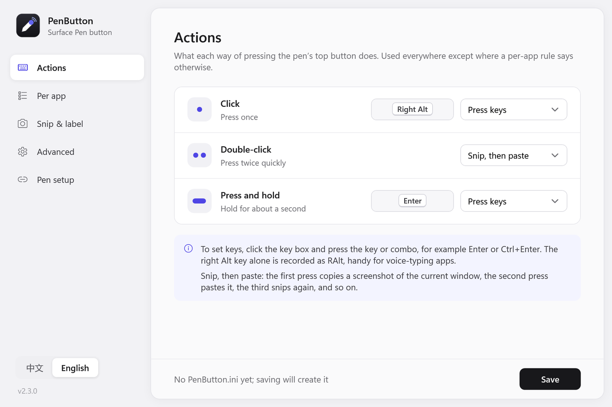
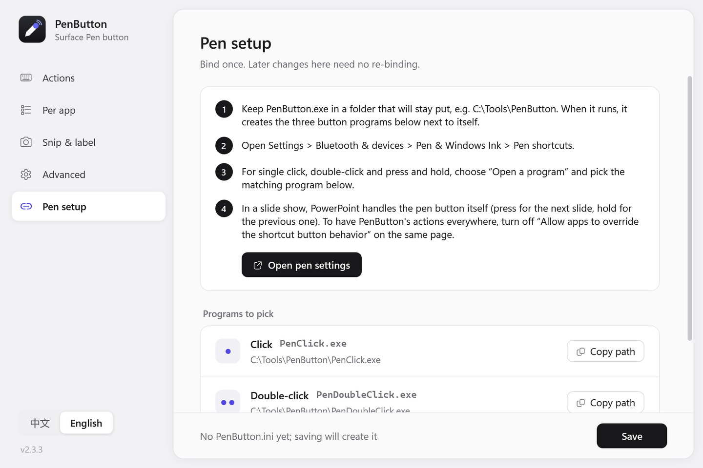
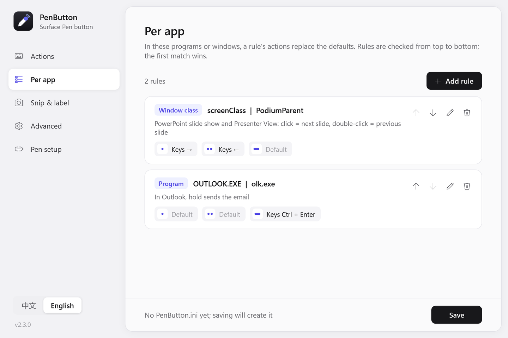
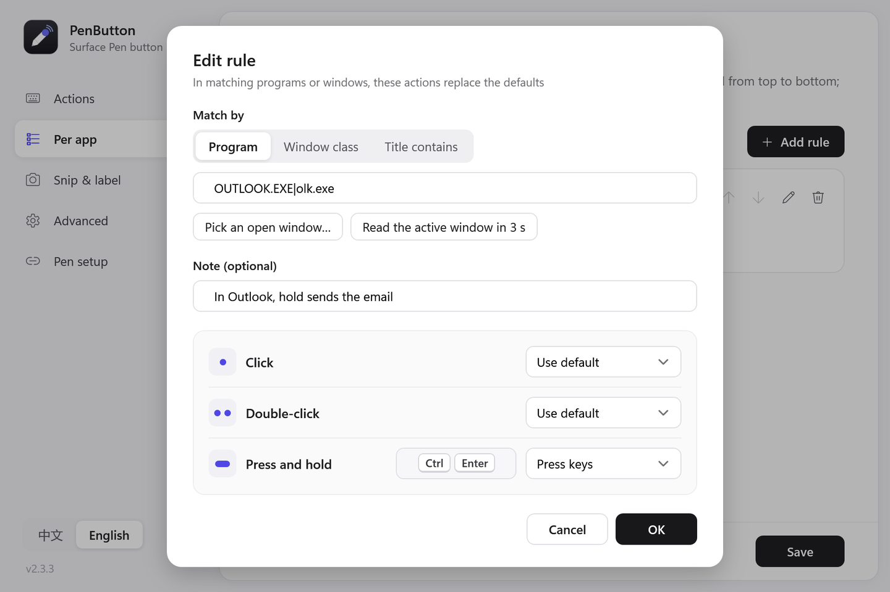
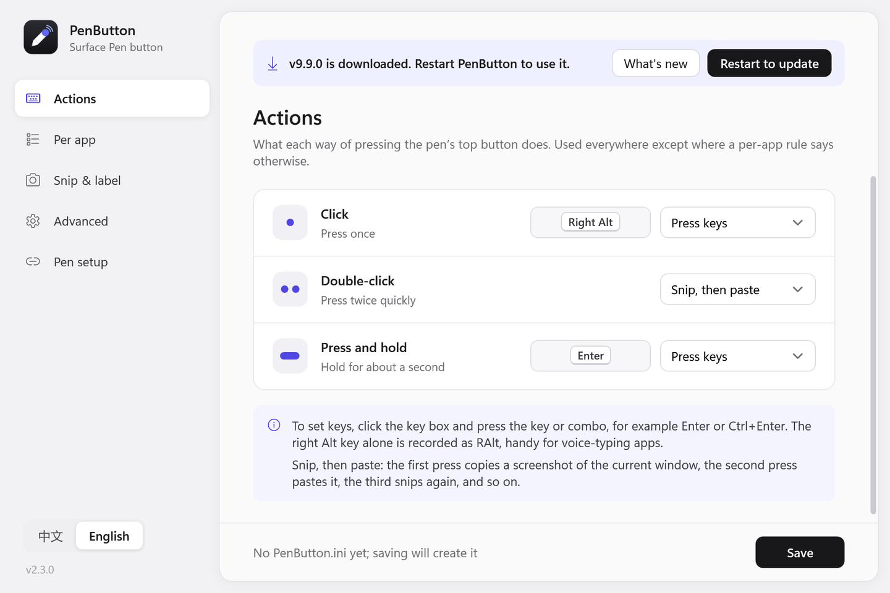

# PenButton

**Give the Surface Pen's top button the actions you actually want.**

[中文说明](README.zh-CN.md) · [Download PenButton.exe](https://github.com/liusong299/surface-pen-button/releases/latest/download/PenButton.exe) · [All releases](https://github.com/liusong299/surface-pen-button/releases)



Windows lets each of the three pen-button gestures (click, double-click, press and hold) open one program. PenButton is that program. Pick what each gesture does in a simple window, and it can even do something different in each app.

- **Press any key or combo.** Right Alt to start voice typing (Typeless and similar apps), Enter to send a message, Ctrl+Enter to send an email, arrow keys, F-keys.
- **Snip, then paste.** The first press copies a screenshot of the window you are in; the next press pastes it. A small label next to the pen says "Captured" or "Pasted".
- **Per-app rules.** For example, in a PowerPoint slide show: click = next slide, double-click = previous slide (set up out of the box).
- **One small file, nothing to install.** No admin rights, no background process. It updates itself from this page.
- **English and Chinese**, switchable at the bottom left of the window.

Made for Windows 11 and pens with a shortcut (top) button, such as the Surface Pen and Surface Slim Pen. Windows 10 should work too but is not tested.

---

## Get started (2 minutes)

### 1. Download

Download **[PenButton.exe](https://github.com/liusong299/surface-pen-button/releases/latest/download/PenButton.exe)** and put it in a folder that will stay put, for example `C:\Tools\PenButton`.

> Windows SmartScreen may say "Windows protected your PC" the first time, because the file is not code-signed. Click **More info**, then **Run anyway**.

### 2. Run it once

Double-click `PenButton.exe`. The settings window opens, and three small helper programs appear next to it, with a grey icon:

|  | `PenButton.exe` | the settings window (the one you open) |
|---|---|---|
|  | `PenClick.exe` `PenDoubleClick.exe` `PenHold.exe` | what the pen button runs (no window) |

### 3. Bind them to the pen

Open the **Pen setup** page and click **Open pen settings** (or go to **Settings > Bluetooth & devices > Pen & Windows Ink > Pen shortcuts**). For each gesture choose **Open a program**, then pick:

- **Single click** → `PenClick.exe`
- **Double-click** → `PenDoubleClick.exe`
- **Press and hold** → `PenHold.exe`



You only do this once. From now on, change things in PenButton and click **Save**; the next press uses them.

### 4. Choose what each gesture does

On the **Actions** page, pick an action from the drop-down next to each gesture. To set a key, click the key box and press the key or combo on your keyboard. The right Alt key alone is recorded as "Right Alt".

---

## Using it

### Actions

| Action | What it does |
|---|---|
| Press keys | Sends the key or combo you recorded |
| Snip, then paste | 1st press: screenshot of the current window to the clipboard. 2nd press: paste. Then it starts over |
| Snip only / Paste | One of the two, every time |
| Run a program | Starts any program, script or shortcut |
| Nothing | Turns the gesture off |

The default setup is: click = Right Alt, double-click = snip, then paste, hold = Enter.

### Different actions in different apps

On the **Per app** page, add a rule to change what the gestures do in one program or window. Rules are checked from top to bottom, and the first match wins. A gesture left on "Use default" keeps its normal action.



When adding a rule you don't need to know the program's name: click **Pick an open window…**, or click **Read the active window in 3 s** and switch to the window (this is how you catch a running PowerPoint slide show).



Ideas:

- **PowerPoint slide show:** click = next slide, double-click = previous slide (included by default).
- **Outlook:** hold = `Ctrl+Enter` to send the email.
- **Chat apps:** hold = `Enter` to send; in apps where Enter makes a new line, use `Ctrl+Enter` or `Shift+Enter` instead.
- **Browser web apps:** match by **Title contains**, for example `Gmail`.

### Snip & label

Choose whether to capture the current window or the whole screen, play a sound, and after how long an unused screenshot should be replaced by a new one. You can also turn the small "Captured" / "Pasted" label off or change its text.

### Updates

When the settings window opens, PenButton checks this page for a new version and downloads it in the background. A bar appears at the top; click **Restart to update**. Your settings and pen bindings stay as they are, and the three helper programs are refreshed automatically. You can turn this off, or check by hand, on the **Advanced** page.



### Language

Switch between 中文 and English at the bottom left of the window. The choice is saved, and the small labels next to the pen follow it.

---

## Questions

**Nothing happens when I press the pen button.**
Check the bindings in Pen shortcuts (step 3). Windows also blocks simulated keys to programs running as administrator, so key actions do nothing there. To see what PenButton did, turn on **Log every press** on the Advanced page and open the log.

**PowerPoint (or another app) does its own thing with the pen button.**
Turn off **Allow apps to override the shortcut button behavior** on the Pen shortcuts page.

**Snip, then paste got out of step.**
Snip and paste only remembers what it did last. If you pasted by hand, the next pen press still pastes once. Press again to start over, or set "Snip again after" on the Snip & label page.

**A Store app is not matched by its program name.**
Store apps often run as `ApplicationFrameHost.exe`. Match them with **Title contains** instead.

**Does it send anything over the internet?**
Only the update check: when the settings window opens it asks GitHub for the latest release (`api.github.com`) and, if there is a newer one, downloads `PenButton.exe` from this repository. The pen-button programs never go online. Turn off **Update automatically** to stop it.

**A button program still shows the old colored icon.**
That is Windows' icon cache. Press F5 in Explorer; if it stays, press Win+R, run `ie4uinit.exe -show`, and the icons are redrawn.

**How do I uninstall it?**
Set the three pen shortcuts back to their defaults and delete the folder. Everything PenButton writes is in that folder (its settings `PenButton.ini` and the optional log), apart from a tiny state file in `%LOCALAPPDATA%\PenButton`.

---

## For developers

Everything is built with the C# compiler that ships with Windows (.NET Framework 4.x, C# 5). No Visual Studio, no NuGet.

```
git clone https://github.com/liusong299/surface-pen-button
cd surface-pen-button
build.bat
```

`build.bat` builds the small button program first, then `PenButton.exe` with it embedded.

| File | What it is |
|---|---|
| `src/Program.cs` | Entry point of PenButton.exe |
| `src/GestureProgram.cs` | Entry point of the button program (PenClick/PenDoubleClick/PenHold.exe) |
| `src/Core.cs` | `PenButton.ini` model, rules, key names, Win32 calls; shared by both |
| `src/PenButton.cs` | The actions: keys, snip/paste, the label next to the pen, log |
| `src/PenButtonSettings.cs`, `src/SettingsWindow.xaml` | The settings window (WPF). The XAML is embedded and loaded with `XamlReader`, so no XAML compiler is needed. Text in `{{中文§English}}` is picked by the UI language |
| `src/Updater.cs` | Update check, download, verification and swap |
| `src/*.ico`, `tools/make_icon.py` | Icons and the script that draws them |
| `tests/` | Tests for the ini parser, rule matching and the updater |

How it works, briefly:

- Windows cannot pass arguments to a pen-shortcut program, so the button program reads its own file name (`PenClick`, `PenDoubleClick`, `PenHold`) to know which gesture fired, runs the action and exits.
- Keys are sent with `keybd_event`; screenshots use the window's visible bounds with per-monitor DPI awareness, so they are sharp at 150 to 200% scaling.
- Updates: PenButton.exe reads the latest GitHub release, downloads `PenButton.exe` as `PenButton.exe.new`, checks its size, SHA-256 and version, renames itself to `.old` (Windows allows renaming a running exe), moves the new file into place and restarts.

Workflow:

- Work on the `dev` branch. Every push builds on Windows, runs the tests, renders every page of the settings window to PNG (see the `screenshots` artifact of the run, or `PenButton.exe --render <folder> --lang en|zh`), and tests the self-update against the real latest release.
- To release, raise `AppInfo.Version` in `src/Core.cs` and merge into `main`. CI publishes a release with `PenButton.exe` when the version is new, and every installed copy offers the update.
- Keep to C# 5 (no `$""`, no `?.`) so the built-in compiler can build it.

Issues and pull requests are welcome.

## License

[MIT](LICENSE)
