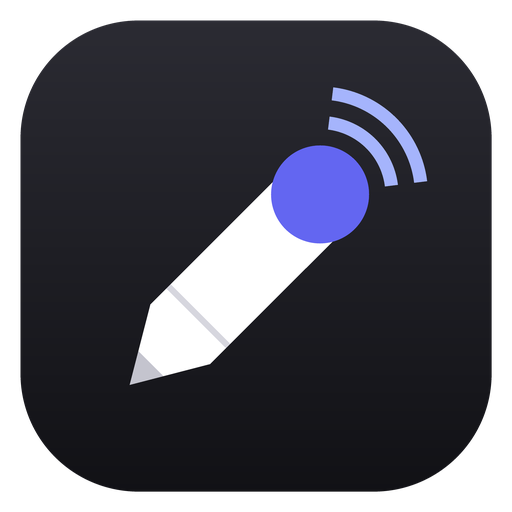
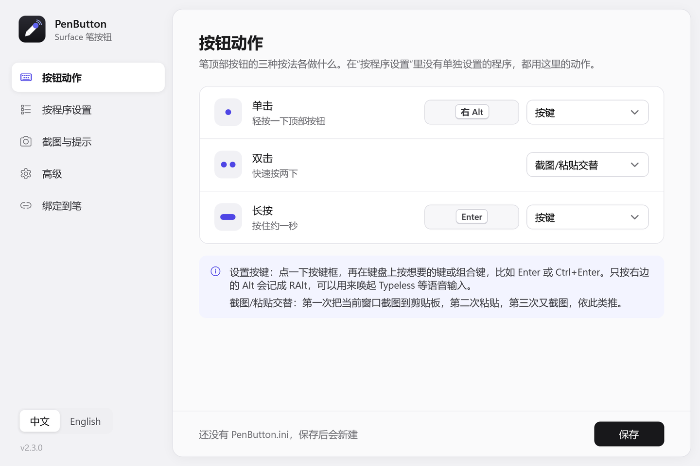
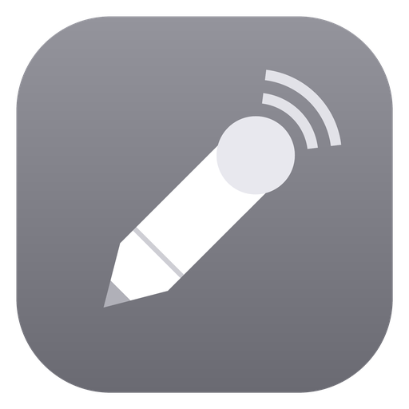
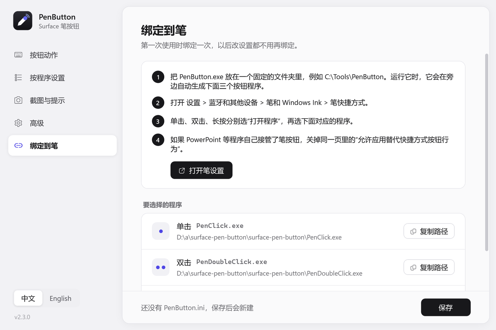
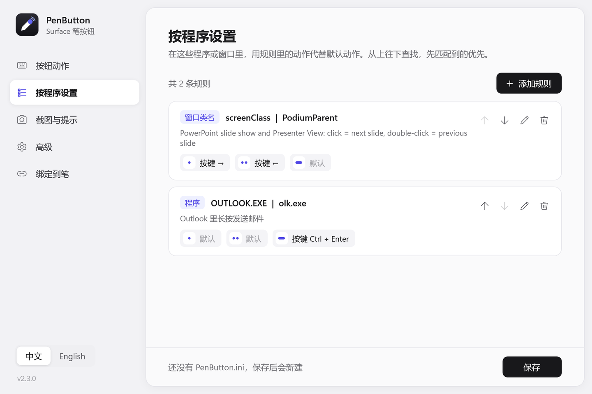
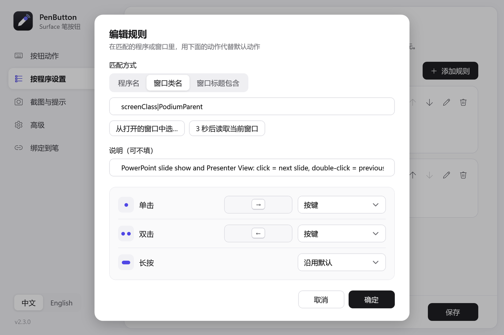
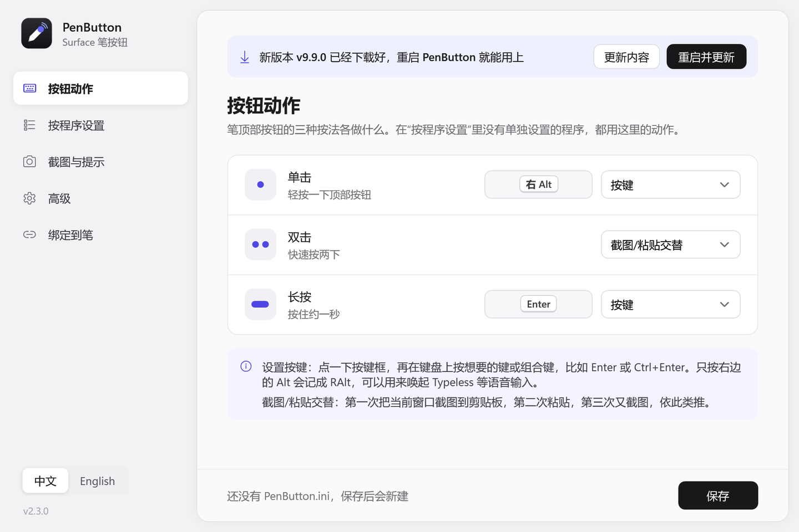

# PenButton

**让 Surface 笔顶部的按钮做你真正想要的事。**

[English](README.md) · [下载 PenButton.exe](https://github.com/liusong299/surface-pen-button/releases/latest/download/PenButton.exe) · [所有版本](https://github.com/liusong299/surface-pen-button/releases)



Windows 允许笔按钮的三种按法（单击、双击、长按）各打开一个程序。PenButton 就是这个程序：每种按法做什么，在一个简单的界面里选就行，还能在不同的软件里做不同的事。

- **按任意键或组合键**：右 Alt 唤起语音输入（Typeless 等），Enter 发消息，Ctrl+Enter 发邮件，方向键、F 键都可以。
- **截图/粘贴交替**：第一次按，把当前窗口截图到剪贴板；第二次按，直接粘贴。笔尖旁边会闪一下“已截图”或“已粘贴”。
- **按程序设置**：比如 PowerPoint 放映时，单击下一页、双击上一页（默认已经设好）。
- **只有一个小文件，不用安装**：不需要管理员权限，不常驻后台，会从这个页面自动更新。
- **中文和英文界面**，在窗口左下角随时切换。

为 Windows 11 和带快捷按钮（顶部按钮）的笔设计，例如 Surface Pen、Surface Slim Pen。Windows 10 应该也能用，但还没测试过。

---

## 快速上手（两分钟）

### 1. 下载

下载 **[PenButton.exe](https://github.com/liusong299/surface-pen-button/releases/latest/download/PenButton.exe)**，放到一个以后不会再移动的文件夹里，例如 `C:\Tools\PenButton`。

> 第一次运行时，Windows 可能提示“Windows 已保护你的电脑”，因为这个文件没有数字签名。点 **更多信息**，再点 **仍要运行** 即可。

### 2. 运行一次

双击 `PenButton.exe`。设置界面会打开，同时在旁边生成三个灰色图标的小程序：

|  | `PenButton.exe` | 设置界面（你平时打开的就是它） |
|---|---|---|
|  | `PenClick.exe` `PenDoubleClick.exe` `PenHold.exe` | 按笔时运行的程序（没有界面） |

### 3. 绑定到笔

打开 **绑定到笔** 页，点 **打开笔设置**（也可以自己打开 **设置 > 蓝牙和其他设备 > 笔和 Windows Ink > 笔快捷方式**）。三种按法分别选 **打开程序**，再选：

- **单击** → `PenClick.exe`
- **双击** → `PenDoubleClick.exe`
- **长按** → `PenHold.exe`



这一步只需要做一次。以后在 PenButton 里改设置、点 **保存**，下次按笔就生效。

### 4. 选择每种按法的动作

在 **按钮动作** 页，从每种按法右边的下拉框里选动作。设置按键时，点一下按键框，再在键盘上按想要的键或组合键。只按右边的 Alt 会记成“右 Alt”。

---

## 使用说明

### 可以选的动作

| 动作 | 效果 |
|---|---|
| 按键 | 发送你录下的键或组合键 |
| 截图/粘贴交替 | 第一次：把当前窗口截图到剪贴板；第二次：粘贴；然后重新开始 |
| 只截图 / 粘贴 | 每次都只做其中一件 |
| 运行程序 | 启动任意程序、脚本或快捷方式 |
| 无动作 | 关掉这个按法 |

默认设置是：单击 = 右 Alt，双击 = 截图/粘贴交替，长按 = Enter。

### 在不同软件里用不同的动作

在 **按程序设置** 页添加规则，可以改变某个程序或窗口里各按法的动作。规则从上往下查找，先匹配到的优先；设成“沿用默认”的按法保持原来的动作。



添加规则时不需要知道程序叫什么：点 **从打开的窗口中选…**，或者点 **3 秒后读取当前窗口** 再切到那个窗口（正在放映的 PowerPoint 就用这个办法）。



几个常用的例子：

- **PowerPoint 放映**：单击下一页，双击上一页（默认已经有这条规则）。
- **Outlook**：长按 = `Ctrl+Enter`，直接发送邮件。
- **聊天软件**：长按 = `Enter` 发送；如果某个软件里 Enter 是换行，就改成 `Ctrl+Enter` 或 `Shift+Enter`。
- **网页里的应用**：用 **窗口标题包含** 来匹配，例如 `Gmail`。

### 截图与提示

可以选截当前窗口还是整个屏幕、要不要提示音、截图后多久没粘贴就重新截图。笔尖旁边的“已截图”“已粘贴”小提示也可以关掉或改文字。

### 自动更新

打开设置界面时，PenButton 会到这个页面查看有没有新版本，有的话在后台下载好。窗口顶部会出现一条提示，点 **重启并更新** 就行。你的设置和笔的绑定都不变，三个按钮程序也会自动更新。想关掉自动更新或手动检查，在 **高级** 页。



### 界面语言

在窗口左下角切换“中文 / English”。选择会被记住，笔尖旁边的小提示也会跟着换语言。

---

## 常见问题

**按笔没有反应。**
先检查第 3 步的绑定。另外，以管理员身份运行的程序会拦截模拟按键，按键类动作在这类窗口里无效。想知道 PenButton 做了什么，可以在 **高级** 页打开“记录日志”，按一下笔再打开日志看。

**PowerPoint 等程序自己接管了笔按钮。**
在笔快捷方式那一页，关掉 **允许应用替代快捷方式按钮行为**。

**截图/粘贴的顺序乱了。**
它只记得自己上一次做了什么。截图后如果自己用键盘粘贴过，下一次按笔仍然会粘贴一次。再按一次就会重新开始；也可以在“截图与提示”页设置“过期重新截图”。

**应用商店里的程序按程序名匹配不到。**
这类程序的程序名经常是 `ApplicationFrameHost.exe`，改用 **窗口标题包含** 来匹配。

**它会上网吗？**
只有检查更新会：打开设置界面时，它向 GitHub（`api.github.com`）查询最新版本，有新版本时从这个仓库下载 `PenButton.exe`。按笔时运行的三个小程序从不联网。不想要的话，关掉 **自动更新** 即可。

**怎么卸载？**
把三种按法的笔快捷方式改回默认，再删掉整个文件夹。PenButton 写的文件都在这个文件夹里（设置文件 `PenButton.ini` 和可选的日志），另外只有 `%LOCALAPPDATA%\PenButton` 里一个很小的状态文件。

---

## 开发

全部用 Windows 自带的 C# 编译器（.NET Framework 4.x，C# 5）编译，不需要 Visual Studio，也不用 NuGet。

```
git clone https://github.com/liusong299/surface-pen-button
cd surface-pen-button
build.bat
```

`build.bat` 先编译按钮小程序，再把它嵌进去编译出 `PenButton.exe`。

| 文件 | 作用 |
|---|---|
| `src/Program.cs` | PenButton.exe 的入口 |
| `src/GestureProgram.cs` | 按钮小程序（PenClick/PenDoubleClick/PenHold.exe）的入口 |
| `src/Core.cs` | `PenButton.ini` 的读写、匹配规则、按键名称、Win32 调用，两个程序共用 |
| `src/PenButton.cs` | 各个动作：发按键、截图/粘贴、笔尖旁的小提示、日志 |
| `src/PenButtonSettings.cs`、`src/SettingsWindow.xaml` | 设置界面（WPF）。XAML 编译时嵌进 exe，运行时用 `XamlReader` 读取，所以不需要 XAML 编译器。写成 `{{中文§English}}` 的文字按界面语言二选一 |
| `src/Updater.cs` | 检查更新、下载、校验、替换 |
| `src/*.ico`、`tools/make_icon.py` | 图标和画图标的脚本 |
| `tests/` | ini 解析、规则匹配和更新功能的测试 |

工作原理简述：

- Windows 的笔快捷方式不能给程序传参数，所以按钮小程序靠自己的文件名（`PenClick`、`PenDoubleClick`、`PenHold`）判断是哪种按法，执行完动作就退出。
- 按键用 `keybd_event` 发送；截图按窗口的可见边界截取，并开启了按显示器的 DPI 感知，在 150% 到 200% 缩放下也清晰。
- 更新：PenButton.exe 读取 GitHub 上最新的版本，把 `PenButton.exe` 下载成 `PenButton.exe.new`，校验大小、SHA-256 和版本号，然后把自己改名成 `.old`（Windows 允许给正在运行的 exe 改名），把新文件放到原位，再重新启动。

开发流程：

- 在 `dev` 分支上开发。每次推送，GitHub 都会在 Windows 上编译、跑测试、把设置界面的每一页渲染成图片（在运行记录的 `screenshots` 里，也可以自己运行 `PenButton.exe --render 文件夹 --lang zh`），并用真实的最新版本测试一遍自动更新。
- 发布新版本时，把 `src/Core.cs` 里的 `AppInfo.Version` 改大，合并到 `main`。版本号是新的，CI 就会自动发布并附上 `PenButton.exe`，已经安装的 PenButton 会提示更新。
- 只用 C# 5 的语法（不要用 `$""`、`?.`），这样系统自带的编译器才能编译。

欢迎提 Issue 和 Pull Request。

## 许可证

[MIT](LICENSE)
